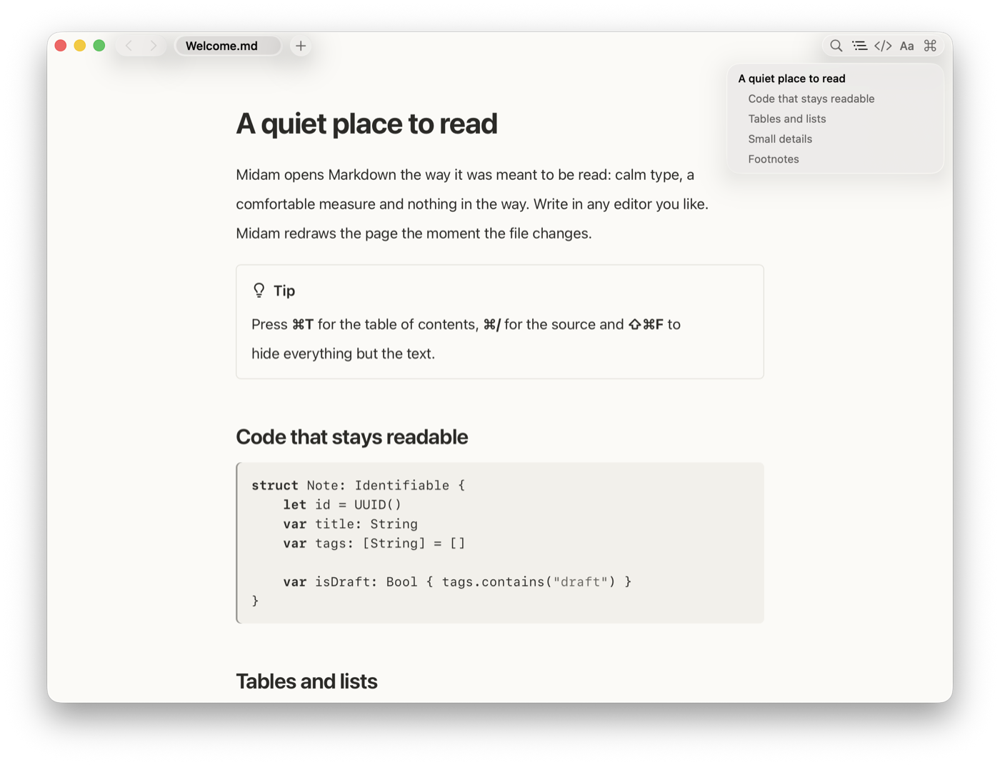
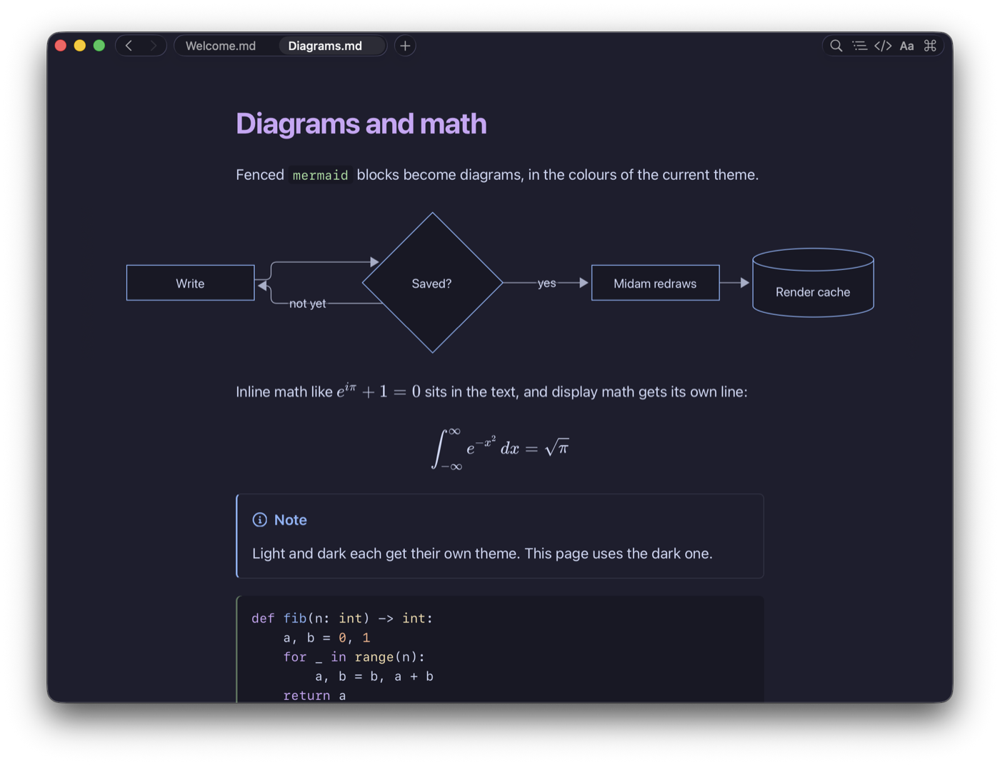
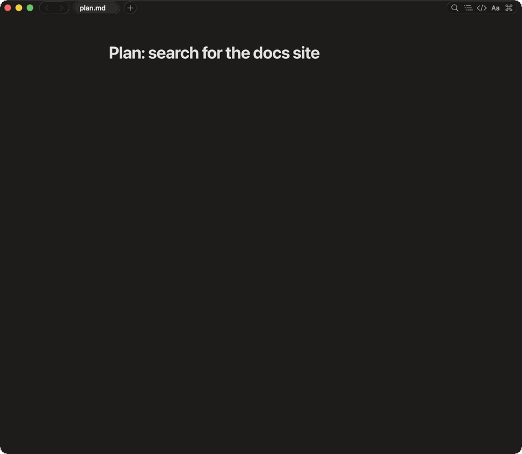

<p align="center"></p>
<h1 align="center">Midam</h1>

<p align="center">A calm, minimalist Markdown viewer for macOS.</p>

<p align="center">
  
  
</p>

## Features

- Live reload when the file changes on disk
- GitHub Flavored Markdown, syntax highlighting, Mermaid diagrams, math (KaTeX), alerts, footnotes, emoji, front-matter table
- Two views: Reading (rendered) and Source (raw Markdown)
- Single window with tabs
- Liquid Glass header
- Colour themes from 10 families (Catppuccin, Gruvbox, Nord, Tokyo Night, Rosé Pine, Everforest, Kanagawa, One, Solarized, GitHub; Nord is dark-only) plus the monochrome Midam theme, chosen separately for light and dark
- Back / forward through links, anchors and tab switches
- A right panel beside the page: find in the document (every match listed with its heading path), the table of contents, and the keyboard shortcuts
- Reading settings and bundled fonts
- English and Korean

<p align="center"></p>
<p align="center"><sub>Live reload: the page follows the file as it changes.</sub></p>

## Agents

Midam can hold a conversation with Claude in a tab beside your documents (File > New Agent…). It needs [Claude Code](https://code.claude.com) installed and signed in: Midam runs the `claude` your login shell finds, in the project's folder, with Claude Code's sandbox on and the wanjang plugin bundled into the app (copied from `WANJANG_DIR`, default `~/workspace/wanjang`, at build time, without its hooks that write to `~/.claude`: ledger, provider-fail and next). Your own Claude settings and the project's still apply.

Every tool use goes through Midam first. These run at once:

- reading, writing and running commands inside the project and the temporary folder
- reading system tools (`/usr`, `/bin`, `/opt/homebrew`), the bundled plugin and Claude's saved output for the project
- web pages, teammates, and connected services whose tool reads (`get…`, `list…`, `search…`, `read…`, `fetch…`, `query…`)

These ask you first, with a card saying why:

- anything outside the project: reading, writing or a command naming such a path (`/…`, `~`, `$HOME`, `..`, a bare `cd`); a project at your home folder or `/` has no inside, so everything there asks
- deleting (`rm`, `git clean`, `git reset --hard`, moving to `/dev/null`), publishing (`git push`, `npm publish`, deploys, releases)
- installing or changing the Mac (`sudo`, `brew install`, global npm, `curl | sh`), a command that wants out of the sandbox, and changes to what runs on its own next time: `.claude/`, `.mcp.json`, `.git/`
- connected services that change something, and anything mentioning Stripe, billing or payment

The sandbox also forbids commands to leave it, and neither commands nor file tools can read `~/.ssh`, `~/.aws`, `~/.gnupg` or `~/Library/Keychains`. The rules read the command text; the sandbox is what holds.

## Install

Download the zip for your Mac from Releases: `Midam-<version>-apple-silicon.zip` (M-series) or `Midam-<version>-intel.zip`. Unzip it in Finder (double-click) or with `ditto -x -k <zip> .`, then move `Midam.app` to `/Applications`. Plain `unzip` drops parts of the app's signature.

The app is ad-hoc signed, not notarized, so macOS blocks the first open. Open it once and click Done, then go to System Settings → Privacy & Security, click Open Anyway next to the Midam message and confirm with your password. You only do this once. On macOS 14, Control-click the app → Open also works. Or clear the quarantine flag in Terminal:

```sh
xattr -dr com.apple.quarantine /Applications/Midam.app
```

Requires macOS 14 or later.

## Build from source

```sh
./build.sh              # release build, installs to /Applications
./build.sh --no-install # build/Midam.app only
./release.sh            # dist/Midam-<version>-{apple-silicon,intel}.zip, one single-arch app each
```

`release.sh` reads the version from `Info.plist`, verifies each binary's architecture and signature, and prints the zips' SHA-256.

### Tests

```sh
for t in tools/*-test.js; do node "$t"; done   # rendering, math, diagrams, fonts, themes
python3 tools/theme-contrast.py                 # WCAG AA for every theme
python3 tools/strings-audit.py                  # en/ko strings complete
sh tools/cli-test.sh                            # the midam command's exit codes
swiftc Sources/Midam/ProjectTabs.swift tools/ProjectTabsTest/main.swift -o /tmp/projecttabs && /tmp/projecttabs
```

The Swift checks in `tools/FontSchemeTest`, `tools/NavHistoryTest`, `tools/TocTest`, `tools/RenderCacheTest`, `tools/TipTest`, `tools/SwipeTest`, `tools/LibraryTest`, `tools/BaselineTest`, `tools/ChangeCountTest`, `tools/ReplyTest`, `tools/ChatMarkdownTest`, `tools/AgentSessionsTest`, `tools/ConversationTest` (permission rules, launch flags, sandbox settings) and `tools/TeamTest` build the same way; each file's header has the exact command. `tools/webkit-test.js` renders pages in headless WebKit through Playwright and is skipped when Playwright is not installed.

## Shortcuts

| Key | Action |
| --- | --- |
| ⌘O | Open file |
| ⌘T | New tab: into the sidebar's list (↩ opens the document in a new tab; ⌘T or Esc back to the page) |
| ⌘W or x | Close tab |
| ⌘1–9 | Go to tab (⌘9: last tab) |
| ⌘[ / ⌘], two-finger swipe | Back / forward |
| ⌃Tab / ⌃⇧Tab, ⇧⌘[ / ⇧⌘] | Next / previous tab; ⇧⌘[ previous, ⇧⌘] next |
| ⌘F or / , ⌘G / ⇧⌘G | Find: the panel's Find tab, every match listed / next / previous (Esc back to the page) |
| ⌘+ / ⌘− / ⌘0 | Text size larger / smaller / default |
| ⌘/ | Toggle Reading / Source (also the </> button in the header) |
| ⌥⌘I | Show / hide the right panel (also the panel button at the header's right) |
| ⌥⌘T | The panel's Contents tab (again: hide the panel) |
| ⇧⌘L or ⌃⌘S | Show / hide the sidebar (also the sidebar button in the header) |
| ⇧⌘F | Immersive mode: hide the header |
| ⌘R | Reload |
| ⌥⌘R | Show in Finder |
| ⌃⌘F | Full screen |
| Space / ⇧Space, ⌘↓ / ⌘↑ | Page down / up, bottom / top |
| j / k, G / g | Line down / up, bottom / top (Vim style; off while typing in Find) |
| d / u (or e), f / b | Half page down / up, full page down / up (Vimium style) |
| m | Note on the selected passage (also the Add Note button by a selection); off while typing |
| ⌘↩ | Send the reply: to the agent waiting in `midam review`, else to the clipboard |
| ⌘, | Settings |

Press ⌘' (or Help › Keyboard Shortcuts) to see this list in the panel's Shortcuts tab. Fonts and text size live in Settings (⌘,) and the Format menu.

## Command line

Settings › General › Command Line Tool › Install links `~/.local/bin/midam` to the script inside the app (no admin rights; Settings shows the line to add if that folder is not on your `PATH`).

```sh
midam open docs/plan.md:40            # open a document in Midam at line 40
midam review docs/plan.md --wait      # open it on the Reply tab and wait; prints the reply Markdown
midam review docs/plan.md --wait --timeout 600
midam status docs/plan.md --json      # last read, draft notes, and so on
midam --help
```

Select a passage and press `m` to note it; the panel's Reply tab collects the notes, a verdict (Approve / Request changes) and a summary, and ⌘↩ sends it. `midam review` exits 0 approved, 10 changes requested, 20 timed out (default 3600 s, `0` waits forever, or `$MIDAM_TIMEOUT`), 2 no such file, 3 Midam not available, 64 usage error. JSON goes to stdout, messages to stderr. The document itself is never changed.

## Third-party credits

Fonts and their licences: `Resources/Fonts/LICENSES/`. Themes: `Resources/THEMES.md`. Libraries: [marked](Resources/marked.LICENSE.txt), [highlight.js](Resources/highlight.LICENSE.txt), [Mermaid](Resources/mermaid.LICENSE.txt), [KaTeX](Resources/katex.LICENSE.txt), plus emoji and Octicons licences in `Resources/`.

## License

[MIT](LICENSE)
