# GitHub-style extensions · 깃허브식 확장

This page exercises everything Midam renders beyond plain GFM. The table above is the front matter. 위의 표는 문서 머리말(front matter)이에요.

## Alerts · 알림

> [!NOTE]
> Useful information that users should know, even when skimming. 훑어 읽을 때도 알아야 할 내용.

> [!TIP]
> Helpful advice for doing things better or more easily.

> [!IMPORTANT]
> Key information users need to know to achieve their goal.
>
> A second paragraph, with `code` and a [link](https://example.com).

> [!WARNING]
> Urgent info that needs immediate attention. 바로 확인해야 해요.

> [!CAUTION]
> Advises about risks or negative outcomes of certain actions.

> [!note] Lower case works too, but text on the marker line makes this a plain quote.

> A plain quote stays a plain quote.

## Footnotes · 각주

Midam keeps the reading calm.[^calm] Footnotes number by first use,[^2] and a second reference to the same note gets its own back-link.[^calm] 한글 문장에도 각주를 달 수 있어요.[^ko] A reference to a note that does not exist stays text: [^missing].

[^calm]: Quiet type, one column, no chrome.
[^2]: The second note, with **bold** text.

    It continues in an indented paragraph.
[^ko]: 각주 본문도 한글로 씁니다.

## Emoji

Shortcodes become emoji: :smile: :+1: :tada: :rocket: :heart: :kr: — but not in code: `:smile:` and

```text
:tada: stays as typed in a code block
```

Unknown names stay as typed: :not_an_emoji:. Times like 10:30:00 are untouched.

## Math · 수식

Inline math: $e^{i\pi} + 1 = 0$ and the area is $\pi r^2$. Prices stay prices: it costs $5 and $10, or $20,000 in total. An escaped \$ is a dollar.

Display math with `$$`:

$$
\int_0^\infty e^{-x^2}\,dx = \frac{\sqrt{\pi}}{2}
$$

A `math` fence:

```math
\begin{aligned}
\nabla \cdot \mathbf{E} &= \frac{\rho}{\varepsilon_0} \\
\nabla \times \mathbf{B} &= \mu_0 \mathbf{J} + \mu_0 \varepsilon_0 \frac{\partial \mathbf{E}}{\partial t}
\end{aligned}
```

수식 안의 한글: $\text{넓이} = \pi r^2$. A broken formula shows its source quietly: $\frac{1}{$.

## Diagrams · 다이어그램

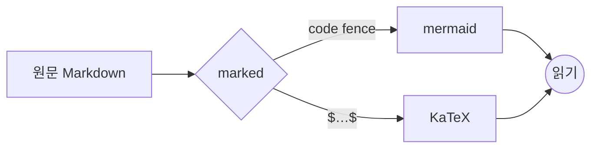

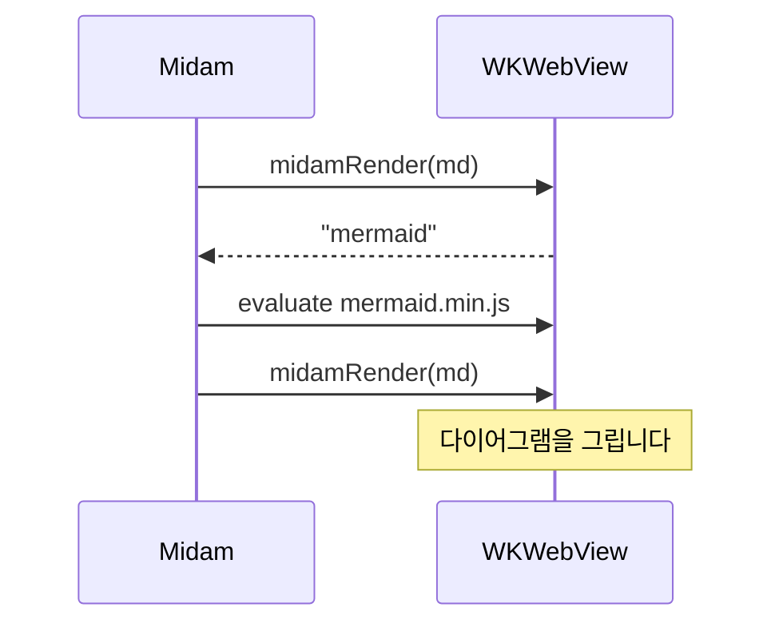

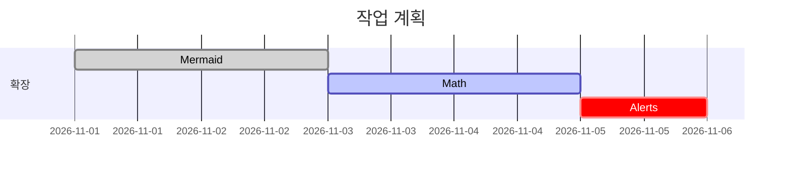

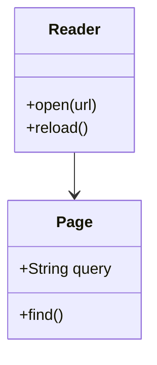

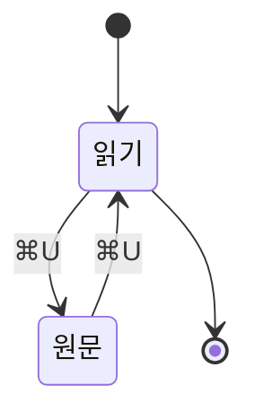

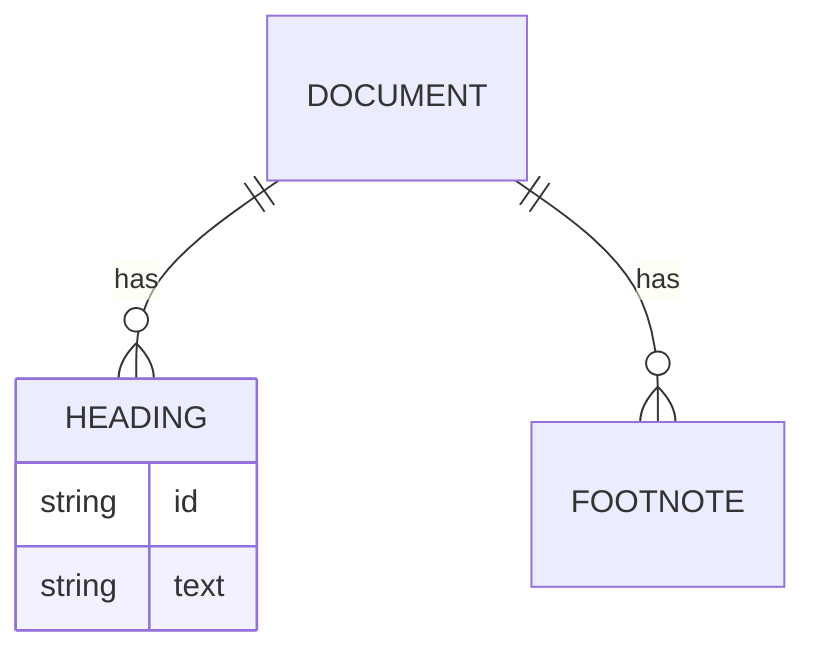

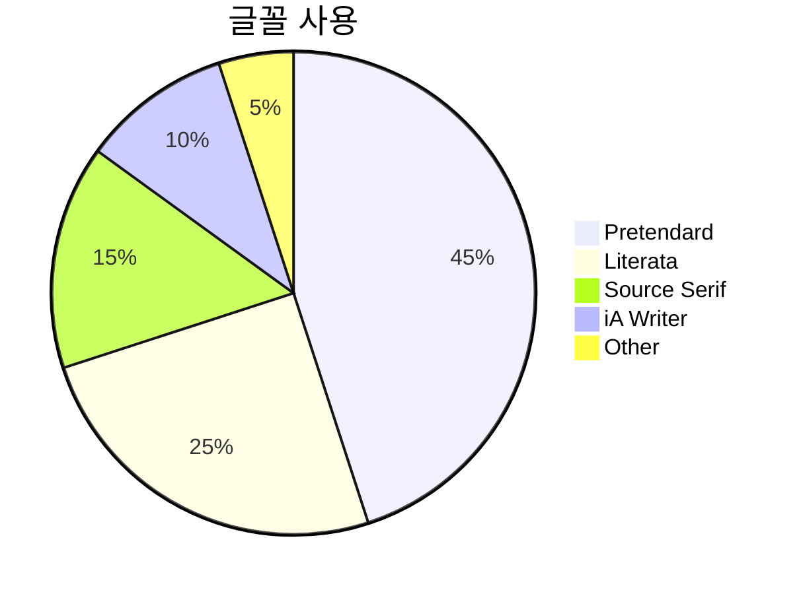

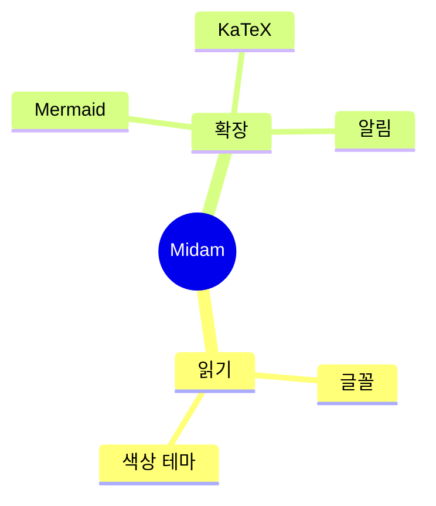

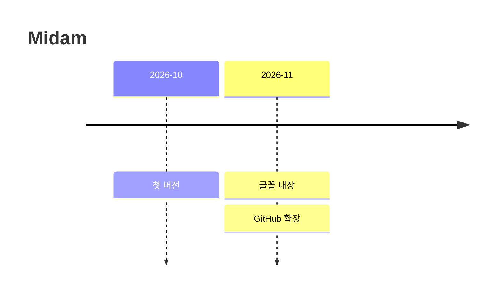

A wide diagram breaks out of the column to the window's width, and scrolls inside itself when it is wider still:

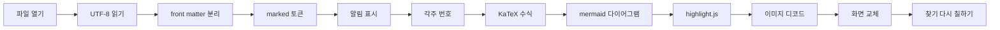

A diagram with an error keeps its code and one quiet line:

```mermaid
flowchart LR
  A --> 
```

## Images for light and dark · 밝은 모드와 어두운 모드

Only the image for the current appearance shows:


The same with `<picture>`:

<picture>
  <source media="(prefers-color-scheme: dark)" srcset="variant-dark.svg">
  
</picture>

## Hostile input · 적대적 입력

Everything below must render inert: no link that runs script, no HTML from labels, no clicks.

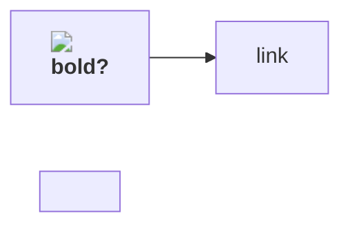

KaTeX with `trust: false`: $\href{javascript:alert(1)}{click me}$, $\url{javascript:alert(1)}$, $\htmlClass{evil}{x}$, $\htmlId{content}{y}$, $\htmlStyle{color:red}{z}$, $\htmlData{foo=bar}{w}$, $\includegraphics{https://example.com/x.png}$.

A footnote label never reaches an attribute: a note[^x"onmouseover="alert(1)].

[^x"onmouseover="alert(1)]: The label never reaches an attribute; notes are numbered.
